# Mega Acerto

Sistema local de análise das loterias da Caixa: histórico oficial de sorteios, palpites, montagem de jogos, controle de apostas e análises estatísticas feitas pelo Claude. Uso exclusivamente local, sem publicação.

O objetivo, o fluxo e as telas estão em [Como funciona e objetivo](#como-funciona-e-objetivo), no fim deste arquivo.

## Ambientes

O projeto tem dois ambientes Docker independentes, cada um com seu próprio PostgreSQL e volume. Nada do desenvolvimento alcança os dados de produção.

|                       | Produção                     | Desenvolvimento                            |
| --------------------- | ---------------------------- | ------------------------------------------ |
| Arquivo               | `docker-compose.yml`         | `docker-compose.dev.yml`                   |
| Projeto Docker        | `mega-acerto`                | `mega-acerto-dev`                          |
| Volume do banco       | `mega-acerto_dados-postgres` | `mega-acerto-dev_dados-postgres`           |
| Aplicação             | `http://localhost:3000`      | API `:3100` e Vite `http://localhost:5173` |
| Banco exposto no host | não                          | `localhost:5442`                           |
| Uso                   | seus dados reais             | codificar e testar, inclusive pela IA      |

Os dois podem rodar ao mesmo tempo. A produção não publica a porta do banco, então nenhuma ferramenta de desenvolvimento consegue se conectar a ela por engano. Os dados de desenvolvimento são descartáveis e podem ser recriados a partir da produção a qualquer momento.

## Pré-requisitos

- Docker com Docker Compose v2 (`docker compose version`)
- Node 24 e Corepack, somente para o desenvolvimento
- Opcional, para as análises: assinatura Claude Max e o Claude Code instalado na máquina

## Produção

### Subir

```bash
git clone https://github.com/Cafecanudo/mega_acerto.git
cd mega_acerto
cp .env.example .env
docker compose up -d --build
```

Acesse `http://localhost:3000` e crie sua conta no diálogo de login.

| Serviço     | Função                                                                 |
| ----------- | ---------------------------------------------------------------------- |
| `db`        | PostgreSQL 17, sem porta no host                                       |
| `app`       | API e interface web na porta 3000; aplica as migrations ao iniciar     |
| `ai-worker` | Executa as análises pedidas na interface usando o Claude Code headless |

Na primeira execução o `app` importa o histórico completo da Caixa. Com o intervalo padrão de 500 ms entre requisições, a Mega-Sena leva cerca de 30 minutos. A interface funciona durante a importação, que é retomável se o container parar. Depois disso, o último concurso é verificado a cada 30 minutos.

### Atualizar após mudanças no código

```bash
git pull
docker compose up -d --build
```

Só faça isso com código já testado no desenvolvimento: as migrations novas são aplicadas no banco de produção ao iniciar. Faça um backup antes.

### Operação

| Ação                         | Comando                                           |
| ---------------------------- | ------------------------------------------------- |
| Ver status e saúde           | `docker compose ps`                               |
| Acompanhar logs da aplicação | `docker compose logs -f app`                      |
| Acompanhar logs do worker    | `docker compose logs -f ai-worker`                |
| Parar sem perder dados       | `docker compose stop`                             |
| Iniciar de novo              | `docker compose start`                            |
| Consultar o banco            | `docker compose exec db psql -U mega mega_acerto` |
| Remover containers           | `docker compose down`                             |

**`docker compose down -v` apaga o volume do banco de produção**: histórico importado, contas, favoritos, apostas e análises são perdidos.

### Backup e restauração

```bash
corepack pnpm prod:backup
```

Gera `mega_acerto.dump` na raiz (ignorado pelo git). Sem Node, o equivalente é:

```bash
docker compose exec -T db pg_dump -U mega -Fc mega_acerto > mega_acerto.dump
```

Para restaurar, pare a aplicação e o worker antes, para não haver conexões abertas:

```bash
docker compose stop app ai-worker
docker compose exec -T db pg_restore -U mega -d mega_acerto --clean --if-exists < mega_acerto.dump
docker compose start app ai-worker
```

## Desenvolvimento

### Primeira vez

```bash
corepack pnpm install
cp .env.example .env
corepack pnpm dev:db:copiar
corepack pnpm dev
```

- `dev:db:copiar` sobe o banco de desenvolvimento e copia para ele os dados atuais da produção. A produção precisa estar rodando.
- `dev` roda a API em `:3100` (lê o `.env`, que aponta para `localhost:5442`) e o Vite em `http://localhost:5173`.
- Entre com a mesma conta da produção: os usuários também são copiados.

### Comandos

| Ação                                  | Comando                                     |
| ------------------------------------- | ------------------------------------------- |
| Subir só o banco de desenvolvimento   | `corepack pnpm dev:db`                      |
| Recriar os dados a partir da produção | `corepack pnpm dev:db:copiar`               |
| Rodar API e front                     | `corepack pnpm dev`                         |
| Subir o worker de análises do dev     | `corepack pnpm dev:worker`                  |
| Parar banco e worker do dev           | `corepack pnpm dev:parar`                   |
| Lint, typecheck e formatação          | `corepack pnpm lint`, `typecheck`, `format` |

- `dev:db:copiar` substitui todo o conteúdo do banco de desenvolvimento. Pare a API de desenvolvimento antes de rodar.
- O worker de desenvolvimento só sobe com `dev:worker` (perfil `analises`), para não consumir cota sem necessidade. Ele usa o banco de desenvolvimento.
- Para zerar o desenvolvimento por completo: `docker compose -f docker-compose.dev.yml --profile analises down -v`. Esse comando afeta apenas o volume `mega-acerto-dev_dados-postgres`.

## Análises com o Claude (opcional)

Sem token, o projeto funciona normalmente, mas as análises pedidas em **Análises** falham.

1. Na máquina, gere o token da assinatura Max:

   ```bash
   claude setup-token
   ```

2. Grave o valor em `CLAUDE_CODE_OAUTH_TOKEN` no `.env`. Nunca commite esse arquivo.
3. Recrie o worker do ambiente desejado:

   ```bash
   docker compose up -d ai-worker
   ```

   ```bash
   corepack pnpm dev:worker
   ```

## Configuração

O `.env` da raiz serve aos dois ambientes.

| Variável                      | Padrão | Ambiente | Uso                                              |
| ----------------------------- | ------ | -------- | ------------------------------------------------ |
| `APP_PORTA_HOST`              | `3000` | produção | Porta da aplicação no host                       |
| `DB_DEV_PORTA_HOST`           | `5442` | dev      | Porta do banco de desenvolvimento no host        |
| `DATABASE_URL`                | `5442` | dev      | Conexão da API de desenvolvimento                |
| `PORT`                        | `3100` | dev      | Porta da API de desenvolvimento                  |
| `SINCRONIZACAO_AO_INICIAR`    | `true` | dev      | Importar concursos novos ao iniciar a API de dev |
| `LOG_LEVEL`                   | `info` | ambos    | Nível de log                                     |
| `CAIXA_INTERVALO_MS`          | `500`  | ambos    | Intervalo entre requisições à API da Caixa       |
| `SINCRONIZACAO_INTERVALO_MIN` | `30`   | ambos    | Intervalo da verificação de novos concursos      |
| `CLAUDE_CODE_OAUTH_TOKEN`     | vazio  | ambos    | Token da assinatura Max para as análises         |
| `ANALISE_TIMEOUT_MIN`         | `30`   | ambos    | Tempo máximo de uma análise                      |

Dentro dos containers, `DATABASE_URL` e `PORT` são fixados pelo Compose; os valores do `.env` valem apenas para a API rodando na máquina.

## Contas de usuário

- O cadastro é aberto: qualquer pessoa com acesso à porta 3000 pode criar conta. Não exponha a aplicação fora da rede local.
- Favoritos, apostas e análises são separados por usuário. Concursos e valores das apostas são compartilhados.
- A primeira conta criada assume os dados que existiam sem dono.

## Problemas comuns

- **Porta em uso:** defina `APP_PORTA_HOST` ou `DB_DEV_PORTA_HOST` no `.env` e suba o ambiente de novo.
- **`dev:db:copiar` falha com "service db is not running":** suba a produção com `docker compose up -d`.
- **`dev:db:copiar` falha com objetos em uso:** pare a API de desenvolvimento e rode de novo.
- **Front de desenvolvimento não acha a API:** confira `PORT=3100` no `.env`; o Vite encaminha `/api` para `localhost:3100`.
- **Análise falha com "CLAUDE_CODE_OAUTH_TOKEN não configurado":** siga a seção de análises e recrie o worker.
- **Valores das apostas aparecem como "—":** cadastre o preço em **Configurações › Valores**.

## Como funciona e objetivo

### Objetivo

Maximizar o valor esperado das apostas e validar estratégias com backtest, sem prometer previsão. O projeto parte da premissa de que os sorteios são independentes e uniformes: nenhuma escolha de dezenas aumenta a chance de acerto, e toda análise compara o resultado com o que o puro acaso produziria.

Dentro dessa premissa, só há duas alavancas reais:

1. **Custo**: saber quanto se gasta, quanto volta em prêmios e quanto cada estratégia custa, com o balanço de gastos × prêmios e o controle de apostas.
2. **Divisão do prêmio**: combinações pouco populares têm a mesma chance de sair, mas tendem a dividir menos o prêmio. É o critério do palpite da análise de sorteio específico.

Todo o resto (frequências, atrasos, estratégias) existe para ser medido contra o acaso, e não para ser seguido às cegas.

### Fluxo

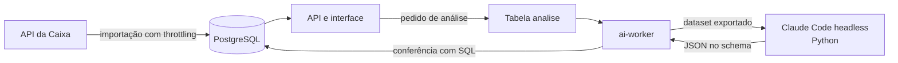

1. **Coleta**: o `app` importa o histórico oficial da API da Caixa, grava o payload bruto e verifica novos concursos a cada 30 minutos.
2. **Organização**: concursos, apostas e favoritos ficam no PostgreSQL. Conferência de acertos, prêmios e frequências são agregações SQL.
3. **Análise**: o pedido entra na tabela `analise`. O `ai-worker` exporta o dataset para uma pasta isolada e executa o Claude Code, que calcula tudo em Python e responde num JSON com schema. O sistema valida o schema e confere as contagens do Claude contra o SQL antes de mostrar o resultado.
4. **Decisão**: palpites, simulador, montagem de jogos, apostas e balanço usam esses dados na interface.

O projeto não implementa cálculo estatístico: ele coleta, organiza, agrega via SQL e valida o que o Claude calcula.

### Tipos de análise

| Tipo                       | Pergunta que responde                                                                     |
| -------------------------- | ----------------------------------------------------------------------------------------- |
| Aleatoriedade e frequência | O histórico é compatível com sorteios uniformes e independentes?                          |
| Estratégia de palpite      | Uma regra de escolha de dezenas teria acertado mais que apostas aleatórias no passado?    |
| Frequência recente         | O top N das dezenas mais sorteadas numa janela recente é diferente do que o acaso produz? |
| Sorteio específico         | O quanto um concurso foi típico, e qual palpite tende a dividir menos o prêmio?           |

### Telas

As imagens abaixo foram geradas no ambiente de desenvolvimento, com uma conta de teste e dados de exemplo.

#### Início

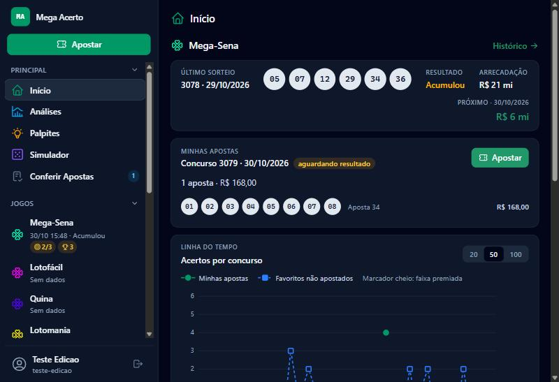

Resumo por jogo: último sorteio, prêmio estimado do próximo concurso e as apostas já feitas para ele, com o selo "aguardando resultado" quando o sorteio passou e ainda não foi importado. O botão Apostar abre o diálogo já no jogo.

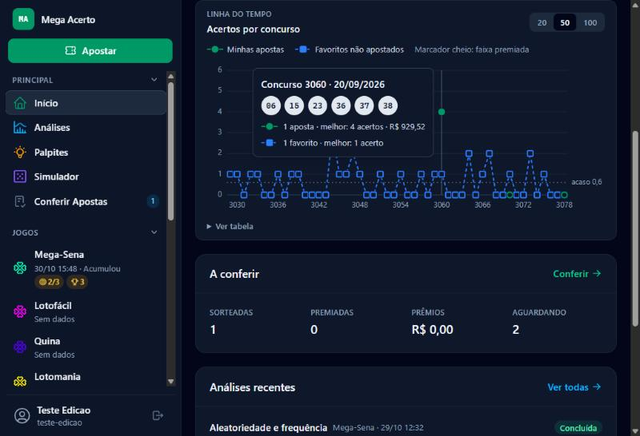

Linha do tempo de acertos por concurso: em verde, o melhor acerto das minhas apostas; em azul tracejado, quanto os favoritos não apostados teriam acertado. A linha pontilhada é a média esperada ao acaso (0,6 para uma aposta simples) e o marcador cheio indica faixa premiada. Abaixo ficam o resumo do que há para conferir, as análises recentes e o balanço de gastos × prêmios.

#### Histórico e concurso

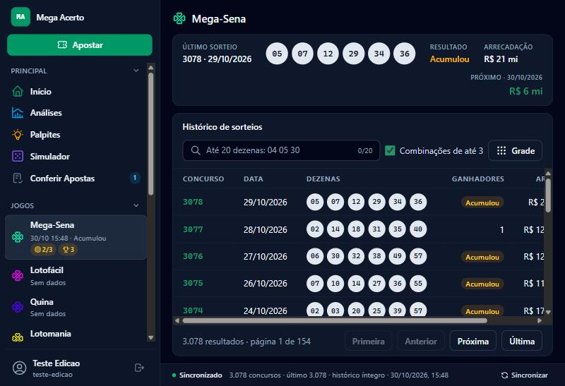

Histórico completo do jogo, com busca por dezenas (inclusive combinações parciais), status da sincronização com a Caixa e paginação.

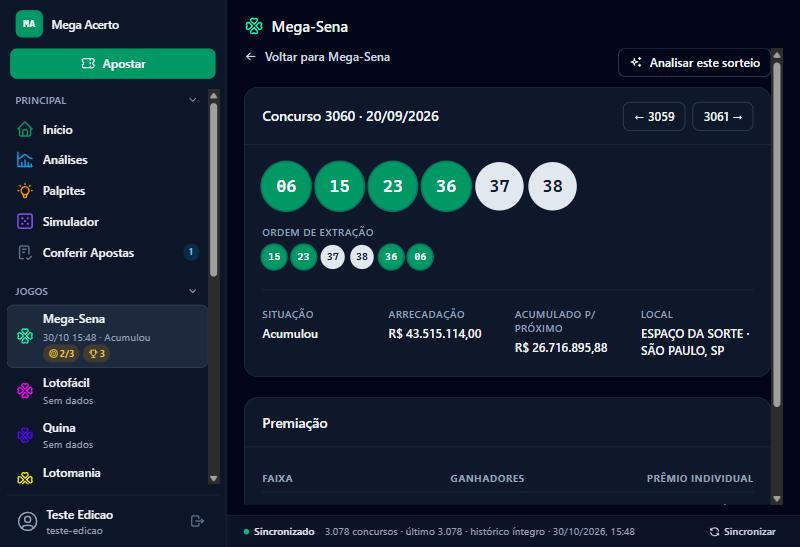

Detalhe de um concurso: dezenas em ordem de sorteio e de extração, premiação e local. As dezenas acertadas pelas minhas apostas ficam verdes. O botão "Analisar este sorteio" pede ao Claude a análise de sorteio específico.

#### Palpites e simulador

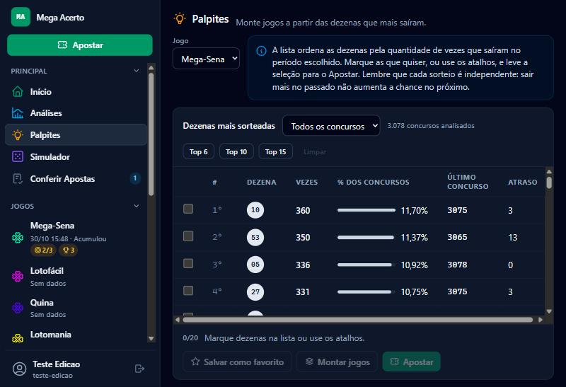

Ranking das dezenas por frequência num período, com atalhos de top 6, 10 e 15. A seleção pode virar favorito, ir para o Apostar ou alimentar o Montar jogos, que gera combinações manuais, todas as combinações ou um sorteio delas.

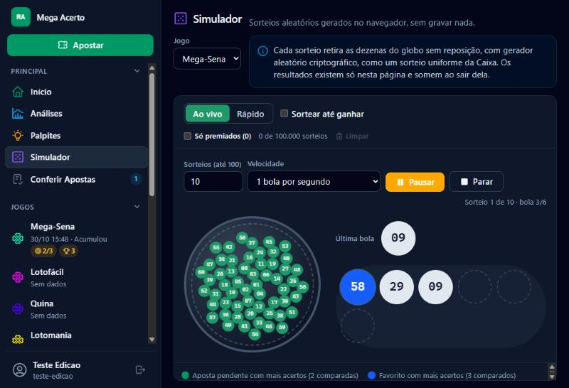

Simulador de sorteios no navegador, sem gravar nada. O modo Ao vivo tira uma bola por vez do globo; o Rápido sorteia em lote. Dezenas que coincidem com apostas pendentes ficam verdes e com favoritos, azuis. "Sortear até ganhar" repete sorteios até a aposta ou o favorito atingir a faixa escolhida e mostra quantas tentativas e quanto dinheiro isso custaria.

#### Apostas

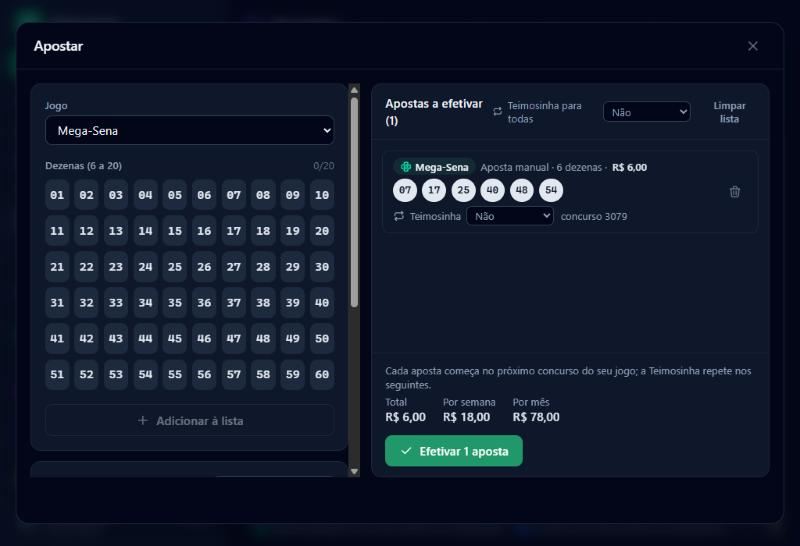

Diálogo Apostar: monta a lista pela grade ou pelos favoritos, com Teimosinha por item ou para todos, e mostra o total a pagar e o custo por semana e por mês antes de efetivar.

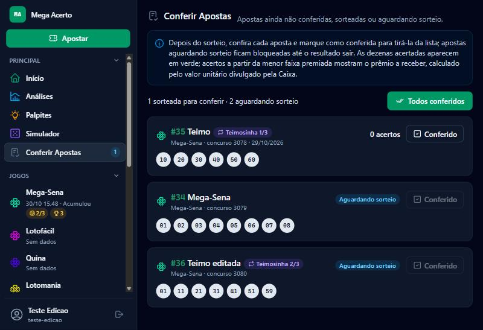

Conferência: apostas sorteadas aparecem com os acertos e o prêmio calculado pelo valor divulgado pela Caixa; as que aguardam sorteio ficam bloqueadas. Cada Teimosinha mostra só a próxima aposta pendente.

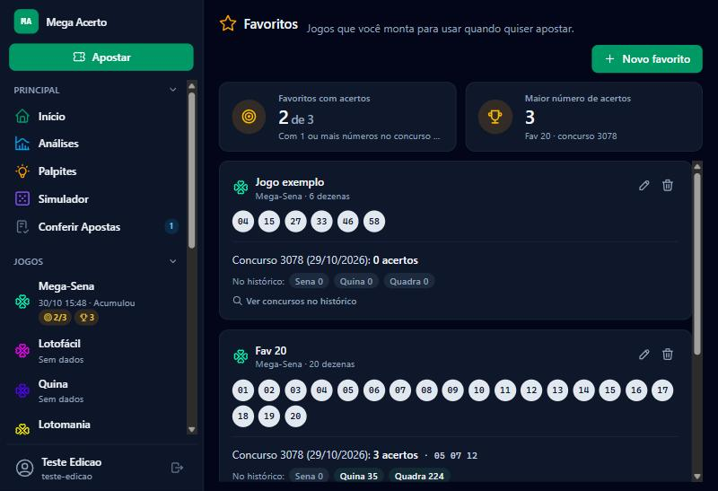

Favoritos: jogos guardados para usar quando quiser, com a conferência contra o último concurso e quantas vezes cada um teria feito sena, quina ou quadra no histórico.

#### Análises com o Claude

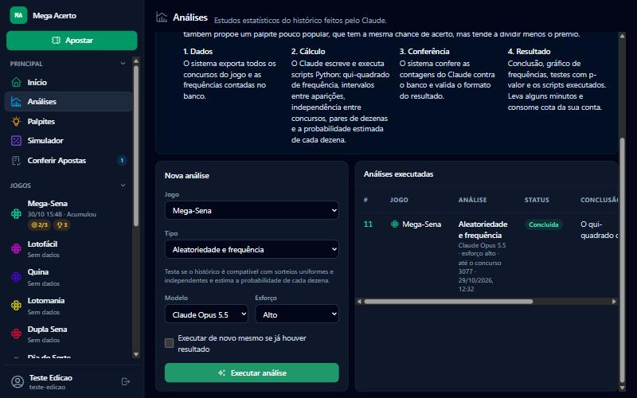

Pedido de análise: escolha do jogo, do tipo, dos parâmetros do tipo, do modelo e do esforço. Resultados com os mesmos parâmetros e o mesmo último concurso são reaproveitados, a menos que se peça para executar de novo.

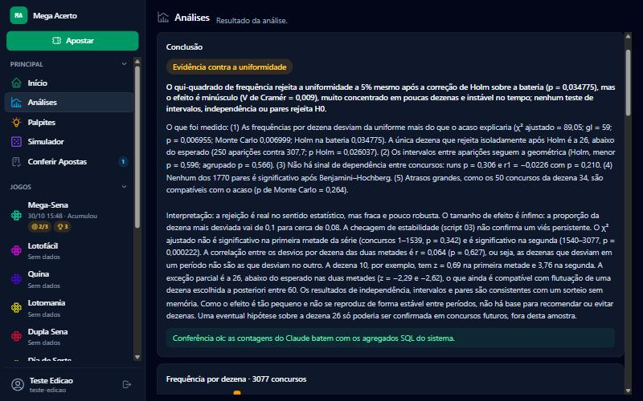

Resultado: conclusão em linguagem simples, separando o que foi medido, a interpretação e as limitações, e a conferência do sistema contra os agregados SQL.

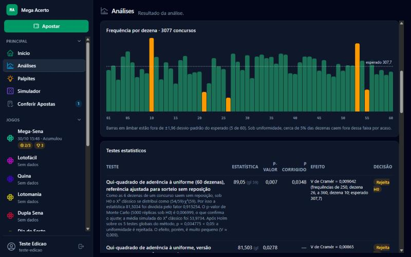

Frequência de cada dezena contra o esperado (barras em âmbar fora de ±1,96 desvio-padrão) e a tabela de testes estatísticos com p-valor, correção para múltiplas comparações e tamanho de efeito. Os scripts Python executados pelo Claude ficam disponíveis no fim da página.
